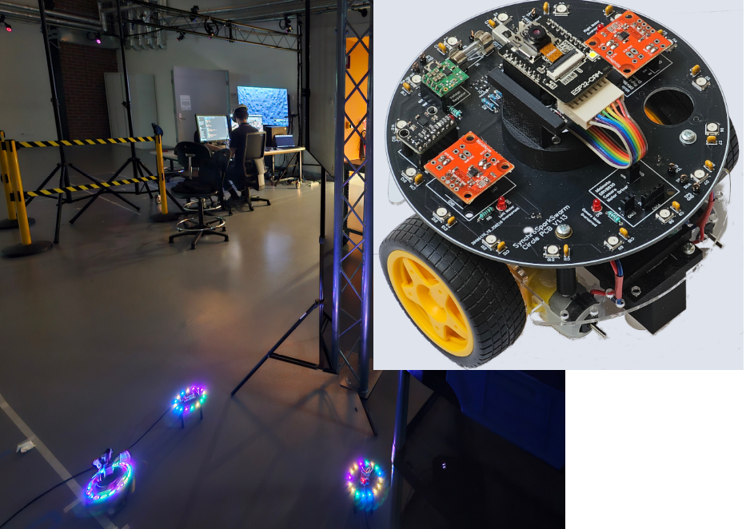
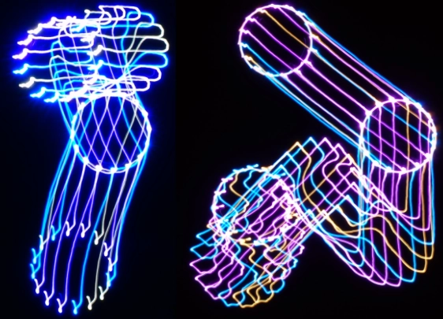
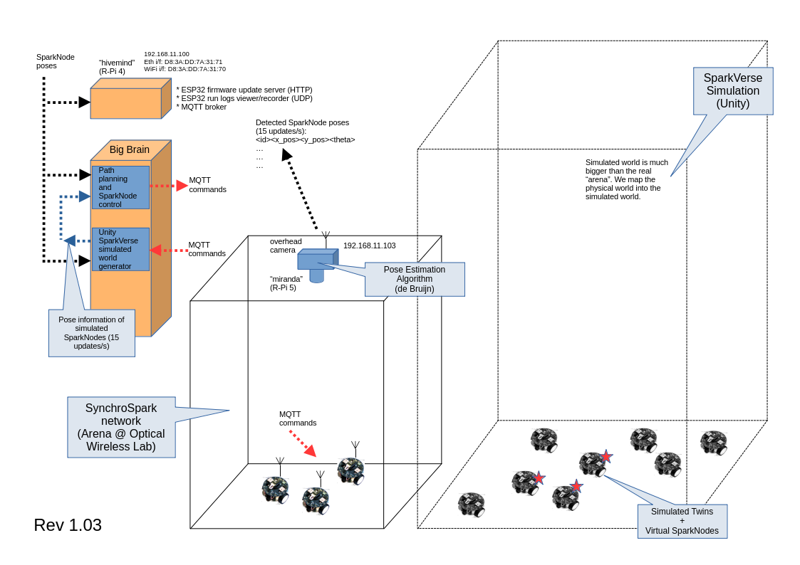

# SynchroSpark Swarm: Mobile Robots for Exploring Swarming, Synchronization, and Formation Control Algorithms

<p align="center">
  
</p>

## Table of Contents

- [Introduction](#introduction)
- [Project Objectives](#project-objectives)
  - [Formation Control Algorithms](#formation-control-algorithms)
  - [Research Collaboration](#research-collaboration)
- [Licensing](#licensing)
- [Project Structure and Terminology](#project-structure-and-terminology)
  - [About the Repository](#about-the-repository)
  - [AI Thinker ESP32-CAM Module](#ai-thinker-esp32-cam-module)
  - [Software Development Platform](#software-development-platform)
- [Testbed Configuration and Operation](#testbed-configuration-and-operation)
  - [Remote Control of SparkNodes with MQTT](#remote-control-of-sparknodes-with-mqtt)
  - [Over-the-Air (OTA) Method for Firmware Upgrades](#over-the-air-ota-method-for-firmware-upgrades)
- [Programs for Testing and Demonstrating Various Functionalities](#programs-for-testing-and-demonstrating-various-functionalities)
  - [OTA-Enabled Programs](#ota-enabled-programs)
  - [Directly Flashable Programs](#directly-flashable-programs)
- [Appendix A: Additional Steps to Create an ESP-IDF Project From Scratch](#appendix-a-additional-steps-to-create-an-esp-idf-project-from-scratch)
- [Appendix B: ESP32-CAM Configuration](#appendix-b-esp32-cam-configuration)
- [Appendix C: Custom Partition Table](#appendix-c-custom-partition-table)

## Introduction

We[^1] are developing a network of low-cost mobile robots for exploring swarming, synchronization, and formation control algorithms, hence the name **SynchroSpark Swarm**. The project's short name is **SyncSpark**, which is
also the name of our main GitHub repository.

Each robot, called a **SparkNode**, has a wheeled base with two motors and an
AI-Thinker ESP32-CAM module. The module is currently mounted in a fixed position.
In a future revision, we plan to place it on a motorized rotating platform so
that we can control the camera angle for 360-degree observation and better
support the study of fully localized algorithms.

## Project Objectives

When we began designing the SparkNodes, our goal was to experiment with
cooperative robotics and explore the intersection of art and technology, with a
particular focus on collaborative robot art. To support this work, we set out to
build a mobile robot platform that was low-cost, compact, practical to produce
in quantities of 30 to 40 units, well connected, and easy to track, at least in
terms of relative pose.

These constraints shaped the project from the beginning. Because cost is a
central concern, our robots do not rely on sophisticated sensors. Instead, we
draw on several low-cost localization strategies from our earlier research:

- Identifying and tracking robots with RGB LED rings and cameras, as described
  in [Partitioning de Bruijn Graphs Into k-cycles for Robot Identification and
  Tracking](https://sekerci.info/~ahmet/papers/de_bruijn_cycles.pdf) (T.
  Grubman, Y. A. Sekercioglu, and D. Wood).
- Trilateration, as explored in
  [Accurate Node Localisation in Ad Hoc Networks Using Directional Pulsed
  Infrared Light
  Communications](https://sekerci.info/~ahmet/pgrad-projects/joseph-thesis.pdf)
  (J. Violi, MEngSc. Thesis).

Together, these studies provide a technical foundation for implementing
formation-control algorithms on the swarm and, ultimately, creating coordinated
dynamic art displays.

<p align="center">
  
</p>

<p align="center"><em>A long-exposure image of two SparkNodes moving randomly, illustrating the project's potential for collaborative robot art.</em></p>

### Formation Control Algorithms

Drawing on our past research in [formation control
techniques](https://sekerci.info/~ahmet/networked_robotics/history.html), we
believe well-established decentralized algorithms are the right starting point
for this platform. They let us study how simple local interaction rules can
produce emergent collective behaviour. The [Boids
algorithm](https://en.wikipedia.org/wiki/Boids) is a natural first example and
will serve as our initial demonstration.

Our second research direction, "Distributed Formation Control Using
Computational Energy Minimization," builds on our earlier work, [Virtual
Localization for Mesh Network
Routing](https://sekerci.info/~ahmet/mesh/virt_loc/) (N. Moore, Y. A. Sekercioglu,
and G. K. Egan). Each robot moves toward a position that minimizes a local
computational energy function, allowing formations to emerge without central
coordination.

In our virtual-localization study, static nodes estimated their positions
iteratively by minimizing a local potential. This potential depended on the
virtual positions of one-hop and two-hop neighbours, which were themselves
estimated iteratively. Although originally developed for sensor-network
localization to support geographic routing, the same principle can guide mobile
robots: virtual positions can be translated into physical movement.

### Research Collaboration

The project has also developed into a research collaboration with the [Shortest
Path Lab (SPL)](https://pathfinding.ai) at Monash University, led by A/Prof
Daniel Harabor. The collaboration focuses on building a mobile robot network to
test multi-agent pathfinding algorithms in realistic physical scenarios.

SPL researches AI planning and heuristic search for single-agent and multi-agent
pathfinding. Its areas of application include trip planning in transportation
networks, motion planning and navigation for mobile robots, and automated
warehouse logistics. SyncSpark provides a practical testbed for taking these
ideas beyond simulation and into embodied multi-robot experiments.

As part of this collaboration, we created
[SparkVerse](./docs/system/sparkverse.md), a mixed-reality environment for
testing algorithms before deploying them on physical robots. Together, SparkVerse
and the SparkNode platform let us explore these ideas in simulated and
real-world settings. [This slide pack](./docs/system/sparkverse_aug2026.pdf)
shows how the physical, simulated, and mixed-reality systems fit together.

## Licensing

This repository contains both software and hardware design materials, which are
licensed according to content type.

- Software source code is licensed under the GNU General Public License v3. See [LICENSES/GPL-3.0.txt](./LICENSES/GPL-3.0.txt).
- Hardware design files under [docs/hardware](./docs/hardware) are licensed under the CERN Open Hardware Licence Version 2 - Strongly Reciprocal. See [docs/hardware/README.md](./docs/hardware/README.md) and [LICENSES/CERN-OHL-S-2.0.txt](./LICENSES/CERN-OHL-S-2.0.txt).

If a file or subdirectory has a different license notice, that notice takes
precedence for the material it covers.

## Project Structure and Terminology

### About the Repository

This repository is an umbrella project (or monorepo) containing multiple ESP-IDF
applications and shared components:

- **Umbrella Project (Monorepo):** The top-level directory (`syncspark`) that
  contains several ESP-IDF application projects and common components.
- **Application Project (Subproject):** A subdirectory of the umbrella project
  (e.g., `sparknode_cam_wifi` or `sparknode_ota_updater`) containing a standalone
  ESP-IDF project with its own `main` folder, `sdkconfig`, and related files.
- **Component:** Shared code or libraries (e.g., in `components/`) that can be
  reused by multiple application projects.

Throughout this documentation, these terms are used to distinguish between the
overall repository, the individual ESP-IDF projects, and the reusable code
modules.

The main directories in the repository are:

- [components](./components/): Shared ESP-IDF components used across projects.
- [docs](./docs/): Hardware, architecture, and supporting project documentation.
- [system](./system/): Host-side utilities, including OTA packaging and log collection.
- [sparkcore](./sparkcore/): The primary OTA-enabled firmware for SparkNodes.
- [sparknode_ota_updater](./sparknode_ota_updater/README.md): The factory-partition OTA updater.
- [get_esp32_chip_info](./get_esp32_chip_info/README.md): A basic direct-flash check of a board and toolchain.

### AI Thinker ESP32-CAM Module

We use the AI Thinker ESP32-CAM module, which is built around the original
dual-core ESP32 chip, not the newer ESP32-S2, ESP32-S3, or ESP32-C3 variants. It
supports WiFi and Bluetooth and has a 240 MHz clock speed, 520 KB of RAM, 8 MB
of PSRAM (SPIRAM)[^2], and 4 MB of flash memory.

### Software Development Platform

We use the [Espressif IoT Development Framework
(ESP-IDF)](https://github.com/espressif/esp-idf) to develop the firmware. Our
development environment is [Visual Studio
Code](https://code.visualstudio.com/) with the [ESP-IDF
extension](https://docs.espressif.com/projects/vscode-esp-idf-extension/en/latest/).

As a basic toolchain check, we use a small program called
[`get_esp32_chip_info`](get_esp32_chip_info/README.md), which reports information
about the chip and its capabilities. This program should be flashed directly to the
factory partition via a USB cable.

## Testbed Configuration and Operation

<p align="center">
  
</p>

<p align="center"><em>The robot-network setup at the Monash Optical Wireless Systems Laboratory, alongside a Unity-based simulation environment. The simulation has a separate [GitHub repository](https://github.com/vedantA04/sparkverse).</em></p>

### Remote Control of SparkNodes with MQTT

We are progressively adding MQTT commands for the remote control of SparkNodes. See
[the information and list of commands](./docs/software/mqtt.md) for details.

### Over-the-Air (OTA) Method for Firmware Upgrades

We primarily use over-the-air (OTA) updates to upgrade firmware. This approach
offers two main advantages:

1. SparkNodes can receive updates without a USB connection, allowing us to
  deploy firmware quickly and bring them online for testing.
2. We plan to have at least 30 SparkNodes in the SynchroSpark Swarm, and OTA
  lets us update firmware across the fleet efficiently.

OTA requires a WiFi LAN. For basic functionality tests, direct USB flashing can
be more convenient. Accordingly, we group our ESP-IDF projects into two
categories:

- [OTA-enabled programs](#ota-enabled-programs), and
- [Directly flashable programs](#directly-flashable-programs)

The example application `sparknode_sample_ota_app` demonstrates the basic
operation of OTA-enabled firmware and can serve as a starting point for new
applications. Once `sparknode_ota_updater` is installed in the ESP32-CAM's
factory partition, other OTA-enabled applications can be built from this example.
These applications are intended for OTA delivery and should not be flashed
directly to the chip over USB.

See [sparknode_ota_updater/README.md](sparknode_ota_updater/README.md) for details
about the OTA update process.

Follow the [OTA workflow](./docs/software/ota.md) to create OTA-capable firmware.
If you are starting from scratch, see [Appendix A: Additional Steps to Create an
ESP-IDF Project From Scratch](#appendix-a-additional-steps-to-create-an-esp-idf-project-from-scratch).

## Programs for Testing and Demonstrating Various Functionalities

### OTA-Enabled Programs

- **[`sparkcore`](sparkcore/)**: The main firmware used on SparkNodes.
- **[`sparknode_sample_ota_app`](sparknode_sample_ota_app/README.md)**: Demonstrates OTA firmware updates and provides a starting point for new SyncSpark firmware.
- **[`sparknode_ledring`](sparknode_ledring/README.md)**: Tests the RGB LED ring control routines.
- **[`sparknode_mqtt`](sparknode_mqtt/README.md)**: Provides an MQTT test application; its `scripts` directory contains SparkNode remote-control examples.
- **[`sparknode_drive_test`](sparknode_drive_test/README.md)**: Tests the motor drivers.
- **[`sparknode_cam_wifi`](sparknode_cam_wifi/README.md)**: Demonstrates basic networking by periodically sending captured image frames to a remote host as UDP datagrams over WiFi.
- **[`sparknode_icm20948`](sparknode_icm20948/README.md)**: Calibrates the sensors, collects data from the ICM20948 9-axis IMU and BMP388 barometric pressure sensors, and applies the Madgwick sensor-fusion algorithm to estimate orientation.
- **[`sparknode_i2c_test`](sparknode_i2c_test/README.md)**: Tests I2C communication with the motor controllers, BMP388 sensor, and GY-912 IMU board, and verifies RGB LED ring operation.
- **[`sparknode_hall_sensors`](sparknode_hall_sensors/README.md)**: Tests the hall-effect sensor routines using interrupts.

### Directly Flashable Programs

- **[`get_esp32_chip_info`](get_esp32_chip_info/README.md)**: Reports the chip configuration and performs basic checks.
- **[`sparknode_ota_updater`](sparknode_ota_updater/README.md)**: Flash this program directly to the factory partition to enable OTA updates. It must remain there for OTA updates to work.
- **[`glow_ledring`](glow_ledring/README.md)**: Illuminates the RGB LED ring with the assigned de Bruijn sequence. Each SparkNode receives a unique ID derived from its base MAC address.
- **[`opti_pose`](opti_pose/README.md)**: Periodically captures images for developing pose-estimation algorithms that will run directly on the ESP32-CAM.

## Appendix A: Additional Steps to Create an ESP-IDF Project From Scratch

1. **Go to the SyncSpark repository directory:**

   ```bash
   cd $HOME/projects/syncspark/
   ```

1. **Create a project:**

   ```bash
   idf.py create-project my_esp_project
   ```

   Replace `my_esp_project` with your chosen project name. The command creates a
   directory with that name and populates it with starter files and
   subdirectories.

1. **Set the target:**

   ```bash
   cd my_esp_project && idf.py set-target esp32
   ```

   The ESP32-CAM uses the original ESP32 chip (ESP32-WROOM-32).

After creating your new project, follow the remaining steps in the
[OTA workflow documentation](./docs/software/ota.md).

## Appendix B: ESP32-CAM Configuration

Before building firmware for a SparkNode, configure several ESP32 properties and
select a custom partition table. The `sdkconfig.defaults` file in this
repository sets the following options:

- **Serial flasher config**: Sets the flash size to 4 MB.
- **Serial flasher config → Flash SPI speed**: Sets the speed to 80 MHz.
- **Component config → ESP System Settings**: Sets the clock speed to 240 MHz.
- **Component config → ESP PSRAM**: Enables support for PSRAM.
- **Component config → ESP PSRAM → Support for external, SPI connected RAM →
  SPI_RAM config → set RAM speed**: Sets to 80 MHz.
- **Partition Table → custom partition table CSV**: Selects this option and
  sets 0x8000 as the "Offset of partition table".

The standard `sdkconfig.defaults` file is in the top-level directory of the
SynchroSpark repository. Each ESP-IDF project directory contains a symbolic
link to this file.

See [sdkconfig and configuration management](docs/software/about_sdkconfig.md)
for more details.

## Appendix C: Custom Partition Table

All OTA-enabled programs use the standard partition table shown below. Each
program's main directory contains a symbolic link to this table.

```bash
    # SynchroSpark Project partition table
    # --> ESP-IDF requires partitions to be aligned to a 4 KB boundary
    # (multiples of 0x1000). In addition to this:
    # --> Partitions of type "app" have to be placed at offsets
    # aligned to 64 KB boundary (multiples of 0x10000).
    #
    # Name,   Type, SubType, Offset,  Size, Flags
    nvs,      data, nvs,     0x9000,  0x6000,
    phy_init, data, phy,     0xf000,  0x1000,
    factory,  app,  factory, 0x10000, 0xF8000,
    ota_data, data, ota,     0x108000,0x2000,
    ota_0,    app,  ota_0,   0x110000,0x2F0000
```

Directly flashable programs use the built-in default partition table.

## Footnotes

[^1]: Ahmet Sekercioglu and Ismet Atalar, creators of the SyncSpark project.

[^2]: The current version of ESP-IDF allows us to use only half of the available
PSRAM capacity.
